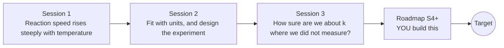

# openarrhenius

[](https://github.com/KrunalPanchal1995/openarrhenius/actions/workflows/ci.yml)   [](https://colab.research.google.com/github/KrunalPanchal1995/openarrhenius/blob/main/sessions/session-01/lesson.ipynb) [](https://krunalpanchal1995.github.io/openarrhenius/)

**Fit a rate constant against temperature and say how sure you are, in three sessions.**

openarrhenius teaches how to fit the Arrhenius law to measured rate constants and how to report the result with an honest uncertainty, using only Python and a browser.

- **Start from zero.** Session 1 needs only school algebra and logarithms; every symbol is explained.
- **See the uncertainty.** Each session ships a slider app with labelled graphs, including a band that flares outside the data.
- **Know you got it right.** Every session ends with a checkpoint that prints PASS or FAIL, and Session 3 checks that the 95 percent interval really contains the truth about 95 times in 100.
- **Build the missing half.** The repo stops at Session 3 on purpose; the roadmap shows the path to the Target.

[Target](#the-target) · [Who is this for](#who-is-this-for) · [Quick start](#quick-start) · [Sessions](#sessions) · [Roadmap](#roadmap) · [Contribute](#contribute) · [Explainer PDF](docs/explainer.pdf)

> **This repo is incomplete on purpose.** Sessions 1 to 3 are here and fully working. The finished Target below is a preview of what the community can build next. We show you the path, not the code. Sessions 4 and up are yours.

## The Target

A 1000/T plot fills with points one at a time. After each arrival the fitted line is redrawn with its 95 percent band reaching out to 2000 K, a small panel shows how the band is narrowest in the middle of the data and flares at the ends, and the (Ea, ln A) confidence ellipse, long and thin because the two parameters are strongly correlated, shrinks around the true value. Your goal over the coming sessions: build that animation yourself, then extend it to curved plots and better-designed experiments.


*Target: points arrive, the fit line, its flaring 95 percent band and the (Ea, ln A) ellipse update*


*Target, one frame: 8 points, band narrowest mid-data, thin tilted ellipse around the truth (star)*

Try it live:

- [Math Visual Studio: rate equations as ODEs (Atlas S16)](https://krunalpanchal1995.github.io/studio/#atlas?ch=S16&ex=1)

How the Target was made is shown only as a path in [promo/roadmap.md](promo/roadmap.md).

## Who is this for
**secondary school to diploma / undergraduate (levels 3-5).** Topic area: Chemistry and Materials Science.

Prerequisites:

- Logarithms and exponentials (ln and exp) and the equation of a straight line.
- Python 3.10 or newer; if `python --version` works, you are ready. PRIMER.md explains the rest.
- No prior GitHub, statistics or chemistry kinetics knowledge is needed.

New to Python? Read [PRIMER.md](PRIMER.md) first (10 minutes).

## Quick start

No installation knowledge needed. You need [Git](https://git-scm.com/downloads) and [Python 3.10+](https://www.python.org/downloads/) (Windows: tick "Add Python to PATH"). On Mac and Linux type `python3` wherever this page says `python`.

```bash
git clone https://github.com/KrunalPanchal1995/openarrhenius.git
cd openarrhenius
python start.py 1
```

`start.py` creates a private environment, installs what is needed and runs Session 1 with its checkpoint. Next: `python start.py 2`, `python start.py 3`, or `python start.py test` to check everything. Only a checkpoint: `python start.py check 1`.

Four lines turn the idea of Session 1 into a result (they work as they are): Save it as `try.py` and run it with `python start.py run try.py` (this uses the private environment, where NumPy is installed):

```python
import numpy as np
T = np.array([600.0, 700.0, 800.0, 900.0, 1000.0])   # kelvin
k = 1e13 * np.exp(-150000 / (8.314 * T))             # rate constants, 1/s (Ea = 150 kJ/mol)
slope, b = np.polyfit(1000 / T, np.log(k), 1)
print(round(-slope * 8.314, 1), "kJ/mol")             # -> 150.0, read off the straight line
```

Every session also opens in your browser with sliders (no install): [live apps](https://krunalpanchal1995.github.io/openarrhenius/). Or use the Colab badge above for the notebook.

## Sessions

| # | Session | Model level | Time | Live app |
|---|---|---|---|---|
| 1 | [Reaction speed rises steeply with temperature](sessions/session-01/README.md) | Level 1: conceptual interactive model | 60 min | [open](https://krunalpanchal1995.github.io/openarrhenius/session-01/) |
| 2 | [Fit with units, and design the experiment](sessions/session-02/README.md) | Level 2: mathematical engineering model | 75 min | [open](https://krunalpanchal1995.github.io/openarrhenius/session-02/) |
| 3 | [How sure are we about k where we did not measure?](sessions/session-03/README.md) | Level 3: simulation and validation | 90 min | [open](https://krunalpanchal1995.github.io/openarrhenius/session-03/) |

Each session follows the same six steps: A real-world problem, B concept and theory, C visual explanation, D interactive simulation, E worked example and experiment, F assessment and design challenge. Each ends with `checkpoint.py`, which prints `PASS` or `FAIL` against reference numbers. Session 3 also contains the real-world mini-project: **Fit Ea and A and predict k at 2000 K with a band**.

## Architecture



| Folder or file | What is inside |
|---|---|
| `sessions/` | three sessions: README (A-F), `lesson.py`, notebook, live app, exercises, activity sheet, checkpoint |
| `promo/` | the Target: media, live links, and the roadmap (path only) |
| `docs/` | `explainer.tex` and the built `explainer.pdf` |
| `tests/` | runs every lesson and checkpoint headless |
| `start.py` | one command to set up and run anything |
| `QUALITY.md`, `RUBRIC.md` | the quality checklist and the scoring rubric |
| `.github/` | CI, PDF build, Pages deploy, issue and PR templates |

## Roadmap

| Milestone | What you will build | Difficulty |
|---|---|---|
| Session 4: Fit a curved Arrhenius plot | A fitting function for k = k1(T) + k2(T) with its own uncertainty band. | advanced |
| Session 5: Design the experiment for the prediction | A small optimiser over seven temperatures between 700 and 1100 K, requiring at least three distinct temperatures so linearity can be checked. | intermediate |
| Session 6: Bootstrap intervals | A residual bootstrap of the 2000 K prediction. | intermediate |
| Session 7: Three-parameter fits and their correlations | A fit_modified that also returns the 3 by 3 covariance and a correlation table. | intermediate |
| Session 8: Animate it yourself | Your own animation of points arriving, the line and band updating and the ellipse shrinking. | advanced |

Full detail with a checkpoint per milestone: [promo/roadmap.md](promo/roadmap.md).

## Contribute
New to GitHub? Read [CONTRIBUTING.md](CONTRIBUTING.md); it starts from zero. Pick an issue labelled `good first issue`. Translations into Hindi, Telugu, Tamil and Malayalam are welcome.

<details>
<summary>Development</summary>

```bash
python start.py test        # runs every lesson and checkpoint
```
Lessons use `# %%` cell markers so they open as notebooks in VS Code. See [QUALITY.md](QUALITY.md) for the standard every session meets.
</details>

## License
MIT. See [LICENSE](LICENSE). Media in `promo/media` is (c) Krunal Panchal, CC BY 4.0.

## Acknowledgments
Part of the [PAN IIT OSS](https://hellofoss.tech-iitb.org/projects) open-source teaching collection, modelled on the structure of [openspline](https://github.com/openspline/openspline). Built on ideas from the Math Visual Studio at https://krunalpanchal1995.github.io/studio/.
