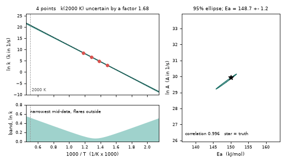
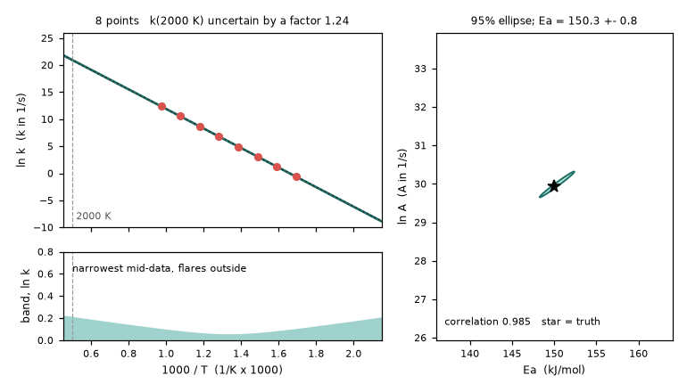

# What you are building toward

A 1000/T plot fills with points one at a time. After each arrival the fitted line is redrawn with its 95 percent band reaching out to 2000 K, a small panel shows how the band is narrowest in the middle of the data and flares at the ends, and the (Ea, ln A) confidence ellipse, long and thin because the two parameters are strongly correlated, shrinks around the true value. Your goal over the coming sessions: build that animation yourself, then extend it to curved plots and better-designed experiments.

*Target: points arrive, the fit line, its flaring 95 percent band and the (Ea, ln A) ellipse update*

*Target, one frame: 8 points, band narrowest mid-data, thin tilted ellipse around the truth (star)*

These results come from a private reference build. The code is not published; the roadmap shows the path so you can build your own.

Live links:

- [Math Visual Studio: rate equations as ODEs (Atlas S16)](https://krunalpanchal1995.github.io/studio/#atlas?ch=S16&ex=1)
