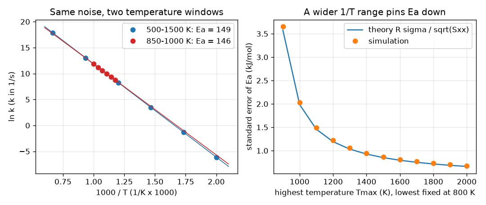

# Session 2: Fit with units, and design the experiment

*Level 2 (mathematical engineering model) · about 75 minutes · openarrhenius*

> This is a simplified educational model. It is not a validated design tool and must not be used for real structures, electrical installations, vehicles, industrial processes or medical decisions.

**Prerequisites**

- Session 1: the Arrhenius law and the ln k against 1000/T plot.
- The idea of a standard error is explained in Section B.

**Learning objectives.** After this session you can:

- Fit ln A and Ea with numpy.polyfit, with and without weights, and report Ea in kJ/mol.
- Compute the standard error of Ea from the spread of 1000/T and check it by simulation.
- Fit the modified Arrhenius form k = A T^n exp(-Ea/(R T)) by linear least squares.
- Choose measurement temperatures to pin Ea down best, and say what the choice costs.

## A. Real-world problem
Every measurement of a rate constant costs a day of lab time and some of the lab's furnace budget. You can afford six temperatures. Should they be bunched in the middle where the reaction is easy to study, or spread as widely as the apparatus allows? And when the answer you want is a number with an error bar, how small can the error bar be made before the experiment is run?

## B. Concept and theory
With x = 1000/T and y = ln k, the fit y = b + s x gives Ea = -s R (kJ/mol) and A = exp(b). If every ln k has the same error sigma (a 5 percent error in k is sigma = 0.05), the standard error of the slope is sigma/sqrt(Sxx), with Sxx the sum of squared distances of the x values from their mean. The standard error of Ea in kJ/mol is therefore R sigma / sqrt(Sxx), which depends only on the chosen temperatures and on sigma, not on the measured values. A wide spread of 1000/T gives a large Sxx and a small error. If different points have different errors, a weighted fit gives each point weight 1/sigma_i. Many papers use the modified form k = A T^n exp(-Ea/(R T)), which is linear in the three unknowns ln A, n and Ea after taking logarithms: ln k = ln A + n ln T - (Ea/R)(1/T). Over a limited range ln T and 1/T are nearly proportional, so n and Ea are hard to separate.

| Symbol | Meaning | Unit |
|---|---|---|
| sigma | error of ln k (a fraction of k) | no unit |
| Sxx | sum of squared deviations of 1000/T from its mean | no unit |
| SE(Ea) | standard error of the fitted activation energy | kJ/mol |
| n | temperature exponent in the modified law | no unit |
| Tmin, Tmax | coldest and hottest measurement temperature | K |

**Assumptions**

- The error of ln k is random, unbiased and the same size for every point unless weights are given.
- The Arrhenius (or modified) law is the correct model.
- Temperatures are known exactly; only k carries error.
- This is a simplified teaching model of an experiment, not a validated design tool.

$$ \mathrm{SE}(E_a)=\frac{R\,\sigma}{\sqrt{S_{xx}}},\qquad S_{xx}=\sum_i\left(\frac{1000}{T_i}-\overline{\frac{1000}{T}}\right)^2 $$

$$ \ln k=\ln A+n\ln T-\frac{E_a}{R}\cdot\frac{1}{T} $$

$$ w_i=\frac{1}{\sigma_i}\quad\text{(weights used by numpy.polyfit)} $$

## C. Visual explanation
The left panel shows the same 5 percent noise on two experiments with six points each: one from 500 to 1500 K and one squeezed into 850 to 1000 K. The wide one hugs the true line; the narrow one can tilt visibly. The right panel plots the standard error of Ea against the highest temperature, with the lowest fixed at 800 K: theory (the line) and simulation (the dots) agree, and the error falls steadily as the range widens.

*Left: the same noise on a wide and a narrow temperature window. Right: standard error of Ea against the hot end of the range, theory and simulation.*

## D. Interactive simulation
Run the lesson (`python start.py 2`), then open the live app: [Session 2: designing a six-point experiment](https://krunalpanchal1995.github.io/openarrhenius/session-02/) (or `app.html` in this folder). Move the cold end, the hot end and the error sliders. In the ruler view see where the six points land on the 1000/T axis, and in the graph see how the standard error of Ea falls as the hot end rises.

**Challenge.** Get the standard error of Ea down to 0.5 kJ/mol or less with a hot end of 1500 K or lower and an error of 5 percent or less.

## E. Worked example and experiment
**Problem.** Temperatures 600, 700, 800, 900 and 1000 K, error 5 percent (sigma = 0.05). Find Sxx and the standard error of Ea, then fit a synthetic data set generated with true A = 1e13 per s and Ea = 150 kJ/mol.

1. x = 1000/T = 1.6667, 1.4286, 1.2500, 1.1111, 1.0000; the mean is 1.2913.
2. Sxx = sum of squared deviations from 1.2913 = 0.2788.
3. SE(Ea) = 8.3145 x 0.05 / sqrt(0.2788) = 0.787 kJ/mol.
4. Fit of the synthetic data (seed 1) with numpy.polyfit: Ea = 149.70 kJ/mol and A = 9.65e12 per s.
5. Check: 149.70 is within 0.3 kJ/mol of 150, inside one standard error (0.787), as expected.

**Answer.** Sxx = 0.2788, SE(Ea) = 0.787 kJ/mol; the fit gives Ea = 149.70 kJ/mol and A = 9.65e12 per s.

**Experiment.** Measure the same reaction at three temperature windows (say narrow, medium and wide) with the same number of runs, fit each, and compare the spread of Ea over repeated experiments with R sigma / sqrt(Sxx). The model predicts the spread well as long as the Arrhenius law holds. In reality a wider window pushes into regions where side reactions, mass transport or catalyst changes bend the plot, so the apparent gain in precision may be paid for with bias.

## F. Assessment and design challenge
**Question type A: Conceptual.** Why does a wider range of 1000/T give a smaller error in Ea, even though the number of data points is the same?

Hint

Think of fitting a line through points: which is easier to tilt, a short row of points or a long row?

Step-by-step solution

The slope of the line is fixed by how y changes across the x range. If the points are spread over a long x range, a given error in y changes the slope only a little (a long lever). If they are bunched, the same error tilts the line a lot. Formally SE(slope) = sigma / sqrt(Sxx) and Sxx grows with the spread.

**Question type B: Numerical.** For temperatures 600 to 1000 K in steps of 100 K and an error of 10 percent, what is the standard error of Ea?

Hint

SE = R sigma / sqrt(Sxx) with Sxx = 0.2788, and sigma = 0.10.

Step-by-step solution

SE = 8.3145 x 0.10 / sqrt(0.2788) = 1.57 kJ/mol. It is exactly twice the 0.787 kJ/mol for 5 percent, because the error is proportional to sigma.

**Question type C: Graph and simulation interpretation.** In the figure, the narrow window (850 to 1000 K) and the wide window (500 to 1500 K) each use six points. What standard errors does the theory give and what is their ratio?

Hint

Read the printed lines of the lesson: SE = R sigma / sqrt(Sxx) for each window.

Step-by-step solution

Wide: Sxx = 1.244 and SE(Ea) = 0.37 kJ/mol. Narrow: Sxx = 0.0218 and SE(Ea) = 2.82 kJ/mol. The narrow window is 7.6 times worse. The simulation in the lesson agrees with both within 5 percent.

**Question type D: Design and optimisation challenge.** Design: six measurements between 500 and 1500 K at 5 percent error. Compare six points evenly spaced in 1000/T with three at each end. Which is better for the error of Ea, and what do you lose?

Hint

Compute Sxx and the SE for both designs with ea_se.

Step-by-step solution

Even spacing gives SE = 0.373 kJ/mol; three points at each end give 0.255 kJ/mol, 32 percent smaller. But with only two temperatures you cannot see whether the plot is a straight line, so a curved plot (a second reaction channel) would go unnoticed. A sensible compromise is points at the two ends plus a few in the middle to check linearity.

Score yourself with [RUBRIC.md](../../RUBRIC.md). Print the [activity sheet](activity_sheet.md) to work on paper.

## Common misconceptions
| Common misconception | What is actually true |
|---|---|
| More points always means a smaller error. | Points bunched at one temperature add little: it is the spread of 1000/T (Sxx) that matters as well as the number of points. |
| The error of Ea depends on how good the particular data look. | For equal errors in ln k, SE(Ea) depends only on the temperatures chosen and on sigma. It can be computed before the experiment. |
| Fitting n as well as Ea is free. | Over a limited range n and Ea are almost perfectly confounded (their correlation with ln A is -0.9998 for n), so the individual values are poorly determined even if the curve fits well. |
| Ea in the fit has units of J/mol. | The slope gives Ea/R in kelvin; multiply by R = 8.3145 J/(mol K) and divide by 1000 to get kJ/mol. Check the units of every number you report. |

## Glossary
- **standard error**: the typical size of the error in a fitted number if the experiment were repeated
- **Sxx**: the spread of the x values: the sum of squared distances from their mean
- **weighted fit**: a fit where each point counts in proportion to how well it is known (weight 1/sigma)
- **modified Arrhenius**: k = A T^n exp(-Ea/(R T)), with an extra power of T
- **design of experiment**: choosing what to measure before measuring, to get the most precise answer

## Finish
1. Do the three coding tasks in [exercises.md](exercises.md).
2. Run `python start.py 2` again after your changes. It ends with the checkpoint; when it prints `PASS`, you are done. (Checkpoint only: `python start.py check 2`.)

Next: [Session 3](../session-03/README.md)
